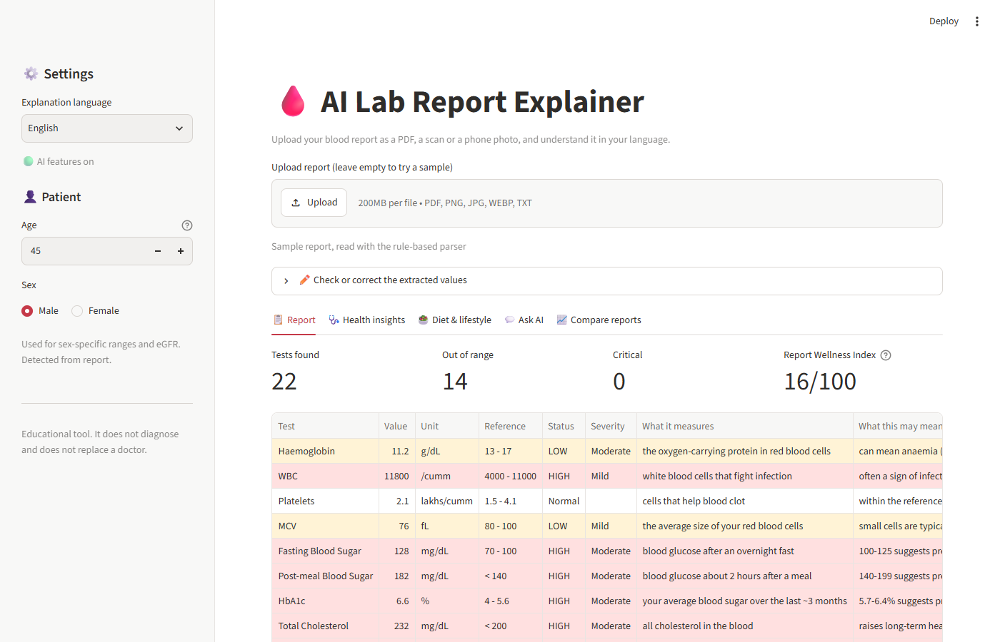
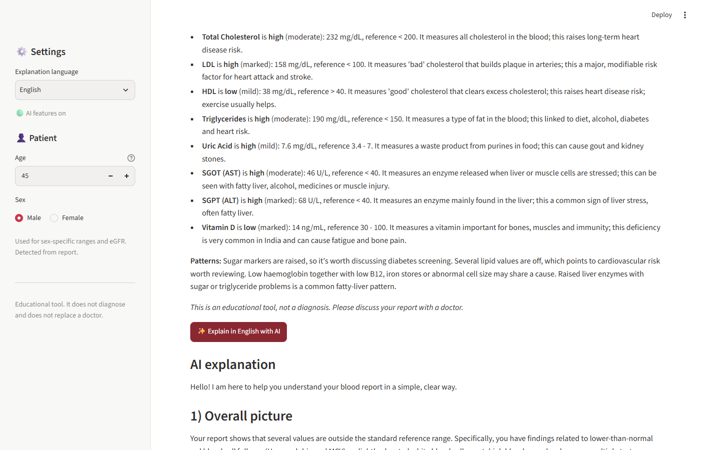
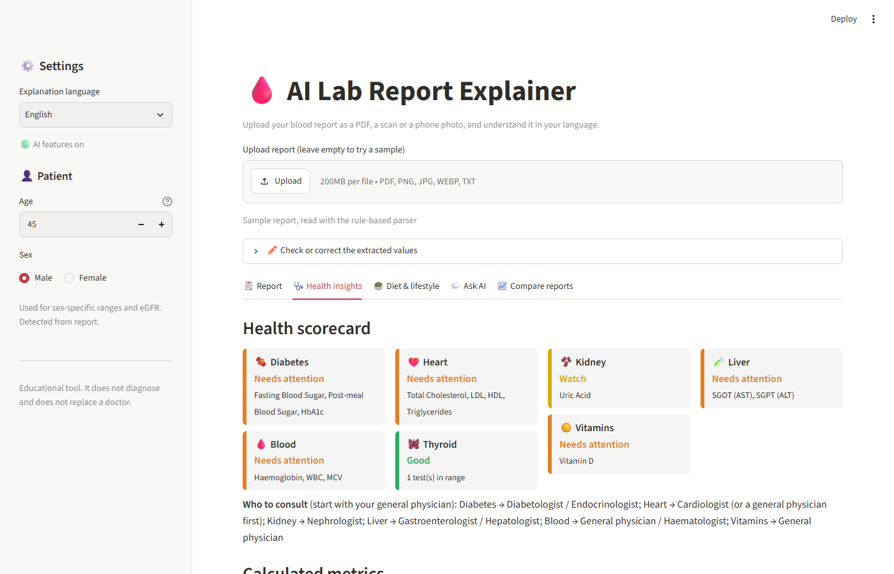
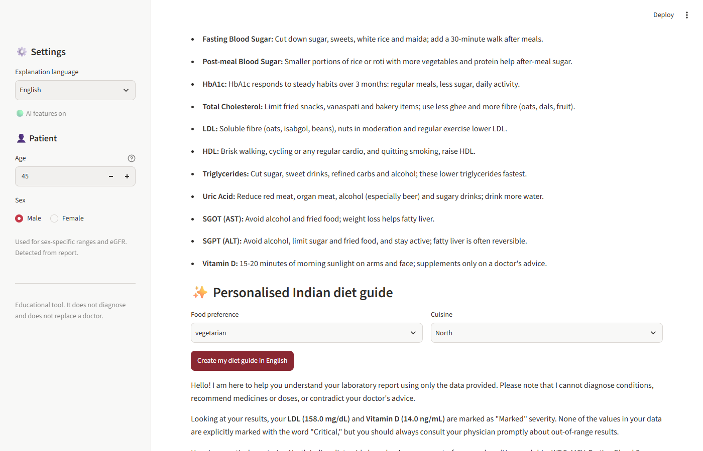
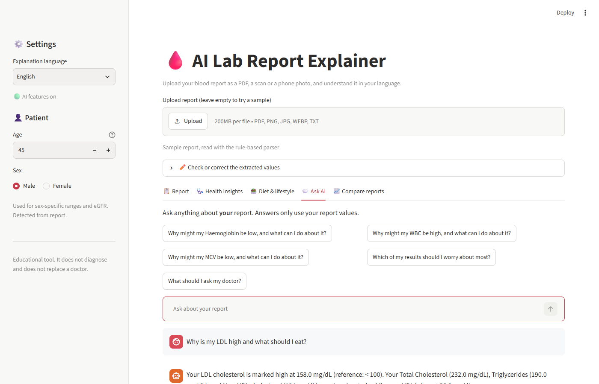
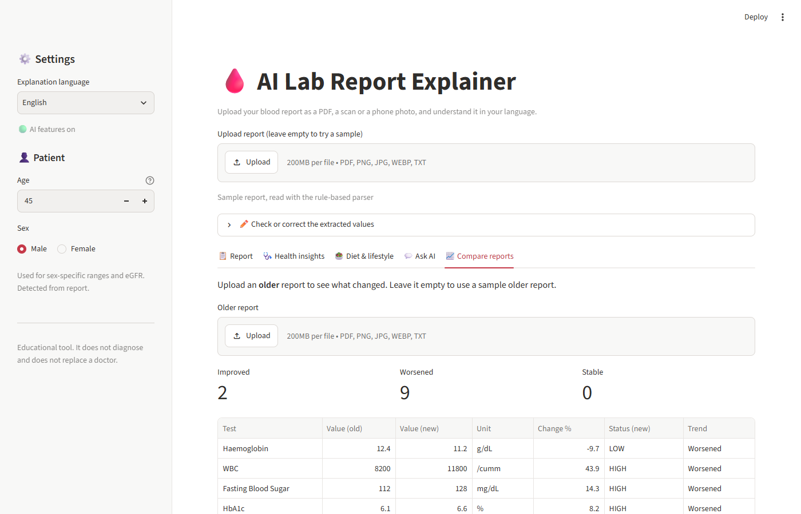

# 🩸 AI Lab Report Explainer

**Upload a blood report as a PDF, a scan or a phone photo, and understand it in your own language.**

Most people in India get a lab report full of numbers and abbreviations and wait days to see a doctor just to learn what it means. This app turns any report into a validated, flagged table, health insights, a plain-language AI explanation in 8 Indian languages, a personalised diet guide, a chat about your own values, and a trend view between reports.

## 📸 Screenshots
| Report with flags and severity | AI explanation with fact-check |
|---|---|
|  |  |
| **Health scorecard and metrics** | **Indian diet guide** |
|  |  |
| **Chat with your report** | **Compare old vs new report** |
|  |  |

🎬 A full walkthrough recording is in [`screenshots/demo.webm`](screenshots/demo.webm).

## ✨ Features
| | Feature | How |
|---|---|---|
| 📷 | **Reads photos and scans** | Gemini Vision extracts every test, plus patient age and sex, as structured JSON |
| 📄 | **Fast offline parsing** | `pdfplumber` + rule-based parser with 120+ name aliases across 31 tests (CBC, sugar, lipids, kidney, electrolytes, liver, thyroid, vitamins, iron, CRP) |
| 🔁 | **Unit conversion** | mmol/L, µmol/L, 10³/µL, nmol/L and more are converted to Indian lab units automatically |
| 🚦 | **Flags with severity** | Lab's own range first, else sex-specific standard ranges; graded Mild / Moderate / Marked / **Critical** |
| 🚨 | **Critical-value alerts** | e.g. potassium ≥ 6.2 or sugar ≥ 400 shows an urgent "contact a doctor today" banner |
| 🩺 | **Health scorecard** | Diabetes, Heart, Kidney, Liver, Blood, Thyroid, Vitamins rated Good / Watch / Needs attention / Urgent, with which specialist to see |
| 🧮 | **Calculated metrics** | eGFR (CKD-EPI 2021), non-HDL, TC/HDL and TG/HDL ratios, Friedewald LDL, estimated average glucose |
| ✏️ | **Human in the loop** | Editable table to correct any misread value; everything recalculates |
| 🗣️ | **AI explanation in 8 languages** | English, Hindi, Tamil, Telugu, Kannada, Malayalam, Bengali, Marathi, with 🔊 read-aloud |
| 🔎 | **AI fact-checker** | Every number in the AI's answer is checked against the report; unknown numbers are flagged |
| 🥗 | **Indian diet guide** | Rule-based tips always; AI plan for veg / non-veg / Jain and North / South / East / West cuisine |
| 💬 | **Chat with your report** | Streaming, multi-turn, grounded only in your values, with suggested questions |
| 📈 | **Compare reports** | Code labels each test Improved / Worsened / Stable (towards or away from normal) + AI summary |
| ⬇️ | **PDF and CSV export** | Summary PDF with scorecard and metrics to take to the doctor |

## 🛡️ Responsible-AI design
- **Hybrid pipeline:** deterministic, unit-tested code does extraction checks, unit conversion, flagging, severity and calculations. The LLM only reads images and explains.
- **Grounding + fact-check:** the LLM gets a validated table, and its output is checked for numbers that are not in the report.
- **Guardrails:** no diagnosis, no medicines or doses, report content treated as data (prompt-injection safe), urgent values escalated to a doctor.
- **Reliability:** retries with backoff, automatic model fallback, API key sent in a header (never in a URL).
- **Graceful degradation:** without an API key, the whole rule-based app still works.

## 🚀 Run it
```bash
pip install -r requirements.txt
streamlit run app.py
```
For AI features get a free key at [Google AI Studio](https://aistudio.google.com/) and paste it in the sidebar, or set `GEMINI_API_KEY` (optional: `GEMINI_MODEL`, default `gemini-flash-lite-latest`). Leave the uploader empty to try the built-in sample; `sample_report.png` lets you try the photo path.

## ✅ Tests
```bash
pytest -q
```
14 tests cover parsing edge cases, unit conversion, sex-specific ranges, critical values, eGFR, fact-checking, trends, the Gemini client (fallback, retry, streaming, JSON) and the full Streamlit app with a fake Gemini.

## 🧱 Architecture
```
PDF / photo ─► text? ─yes─► pdfplumber ─► regex parser ─┐
                 └─no──► Gemini Vision ─► JSON ─────────┴─► items ─► ✏️ editable ─► build_table
                                                                      (units, ranges, flags, severity)
                                                                                │
             insights.py: scorecard · eGFR & ratios · critical alerts · tips · fact-check
                                                                                │
             gemini_client.py: explain · diet guide · streaming chat · trend summary (8 languages)
```
| File | Role |
|---|---|
| `app.py` | Streamlit UI: Report, Health insights, Diet, Ask AI, Compare tabs; PDF/CSV export |
| `knowledge.py` | Test knowledge base: aliases, units, sex-specific ranges, critical values, tips |
| `report_parser.py` | Parsing, unit conversion, flagging, severity, trend comparison |
| `insights.py` | Derived metrics, scorecard, alerts, fact-checker |
| `gemini_client.py` | Gemini REST client with retry, fallback and streaming |
| `tests/` | pytest suite |

**Educational tool, not medical advice.**
